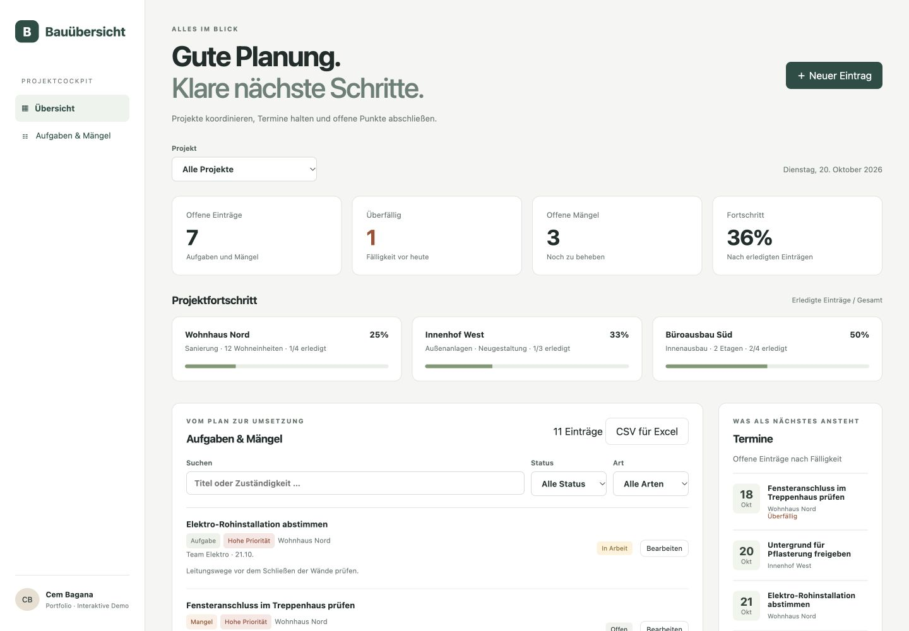

# Bauübersicht

Ein interaktives Bauprojekt-Dashboard für das Portfolio von **Cem Bagana** – gemeinsam mit KI entwickelt, mit vollständig fiktiven Beispieldaten.

[Demo öffnen](https://cem-bagana.github.io/bauprojekt-dashboard/) · [GitHub-Profil](https://github.com/cem-bagana) · [Portfolio](https://www.cembagana.de/)

## Vorschau



*Demo mit fiktiven Beispieldaten.*

## Idee

Aufgaben, Zuständigkeiten, Fälligkeiten und Mängel gehören im Baualltag zusammen. Diese kleine Demo zeigt, wie sich daraus eine verständliche Projektübersicht gestalten lässt. Sie ist ein neues Portfolio-Projekt und keine Referenz aus einem realen Kundenauftrag.

## Ausprobieren

1. Ein Projekt auswählen oder alle Projekte anzeigen.
2. Aufgaben nach Status, Art oder Suchbegriff filtern.
3. Einen Eintrag bearbeiten und auf „Erledigt“ setzen: Fortschritt, offene Mängel und Termine aktualisieren sich.
4. Über „Neuer Eintrag“ eine Aufgabe oder einen Mangel mit Zuständigkeit und Termin ergänzen.
5. „Demo zurücksetzen“ stellt nach Bestätigung die Beispieldaten wieder her.

## Export für Excel

„CSV für Excel“ lädt die aktuell sichtbaren Einträge herunter. Projekt, Status, Art und Suche werden berücksichtigt. Die Datei enthält alle acht fachlichen Spalten einschließlich Notizen, verwendet Semikolons und UTF-8 mit BOM für Umlaute. Bei leerer Trefferliste ist der Export deaktiviert. Formelähnliche Texte werden als Text abgesichert. Die CSV ist eine Momentaufnahme; ein Rückimport ist nicht vorgesehen.

## Funktionsumfang

- Drei fiktive Bauprojekte und elf Beispielaufgaben bzw. Mängel.
- Übersicht für offene Einträge, überfällige Einträge, offene Mängel und Fortschritt.
- Projektfilter für Kennzahlen, Projektkarten, Liste und Termine. Status-, Art- und Textfilter wirken auf die Aufgabenliste.
- Fortschritt als Anteil erledigter Einträge, ohne Aufwandgewichtung.
- Termine nach Fälligkeit, einschließlich überfälliger Einträge.
- Anlegen und Bearbeiten mit Pflichtfeldern, Priorität und Notiz.
- Speicherung im Browser mit verständlichem Hinweis, wenn Speicherung nicht verfügbar ist.
- Responsive Darstellung, Formularbeschriftungen und Tastaturbedienung.

## Technik und lokal starten

Reines HTML, CSS und JavaScript, keine externen Bibliotheken oder Schriften, kein Build nötig.

```sh
python3 -m http.server 8000
```

Anschließend `http://localhost:8000` öffnen. Für neue Einträge wird `crypto.randomUUID()` verwendet: lokal über localhost oder online über HTTPS betreiben.

```sh
node test.cjs
```

Die Tests prüfen kombinierte Filter, leere Ergebnisse, Überfälligkeit, Fortschritt, Datenvalidierung und HTML-Escaping. Zusätzlich wurden Anlegen, Bearbeiten, Speicherung nach Neuladen und Zurücksetzen im Browser geprüft.

## Dateien

- `index.html`: Struktur, Filter und Dialoge
- `style.css`: responsive Gestaltung
- `app.js`: Beispieldaten, Berechnungen, lokale Speicherung und Bedienung
- `test.cjs`: fachliche Tests ohne zusätzliche Abhängigkeiten

## Grenzen

Die Demo hat keine Anmeldung, Rollenrechte, gemeinsame Datenbank, Team-Synchronisation oder Datensicherung. Daten verbleiben im jeweiligen Browser und können durch Löschen des Browserspeichers verloren gehen. Keine realen Kundendaten eingeben. Der Fortschritt ist eine vereinfachte Aufgabenquote, kein gemessener Baufortschritt. Beispieltermine werden bei Erststart und Zurücksetzen relativ zum jeweiligen Tag erzeugt.

## Entstehung

Am 20.10.2026 als KI-unterstütztes Portfolio-Demo-Projekt auf Wunsch von Cem Bagana erstellt. Es verbindet das Thema Baukoordination mit einer direkt nutzbaren digitalen Oberfläche; es wird nicht als allein ohne Unterstützung entwickeltes Kundenprojekt dargestellt.
